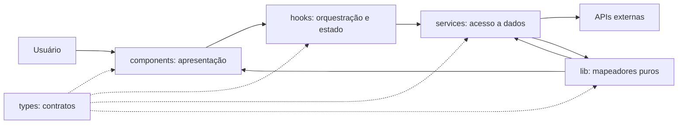

# Plano Técnico: Aplicação de Previsão do Tempo

Este plano deriva de [specs/weather-app-spec.md](../specs/weather-app-spec.md). Define arquitetura, contratos e estratégia de validação; não contém a implementação final. Os campos meteorológicos, regras de geocoding, fuso, timeout e metas operacionais continuam sujeitos aos bloqueios identificados na spec.

## Architecture

Aplicação SPA em React, sem backend próprio, autenticação ou persistência em servidor. A interface chama adaptadores de serviço isolados; estes convertem respostas externas para modelos de domínio antes de expô-las ao estado da aplicação.



Responsabilidades:

- **`components/` (apresentação):** renderiza busca, resultados, clima, previsão, unidade e estados acessíveis. Recebe dados/ações do hook; não chama `fetch` nem conhece payloads Open-Meteo.
- **`hooks/` (orquestração/estado):** coordena query, seleção, requests, retry e unidade; cancela ou descarta respostas antigas. Não contém detalhes de HTTP nem formatação visual.
- **`services/` (acesso a dados):** constrói URLs, chama APIs, trata status/timeout e coordena os mapeadores; retorna tipos de domínio. Não importa React.
- **`lib/` (funções puras):** mapeia payloads, normaliza valores, converte unidades e formata datas/condições; funções determinísticas sem rede, estado React ou efeitos colaterais.
- **`types/` (contratos):** declara tipos de domínio e, se necessário, tipos privados dos payloads externos; não contém lógica.

A dependência segue uma direção: componentes → hooks → services → APIs; `lib/` pode ser chamada pelas camadas que precisam de transformações puras. Essa separação permite testar componentes com hooks simulados, hooks com services simulados, services com `fetch` simulado e `lib/` com testes unitários de entrada/saída.

Não introduzir backend, cache, biblioteca de estado ou biblioteca de dados nesta versão. Caso CORS, termos ou limites do provedor impeçam chamadas diretas do navegador, reavaliar a arquitetura antes de adicionar um proxy.

## Tech Stack

| Área | Decisão | Motivo |
| --- | --- | --- |
| Linguagem e UI | TypeScript strict + React 19 | Stack já instalada; tipos ajudam a manter separados dados do provedor e do domínio. |
| Build/dev server | Vite 8 | Configuração existente e adequada à SPA. |
| Estilo | Tailwind CSS 3 | Stack existente e coerente com as instruções do projeto. |
| Rede | `fetch` nativo + `AbortController` | Suficiente para poucos endpoints; sem dependência adicional. |
| Estado | Estado local React, coordenado por um hook | Fluxo pequeno, sem necessidade de store global. |
| Testes | Vitest, Testing Library, jsdom e Playwright | Dependências e configuração já presentes. |
| Qualidade | Biome | Lint e checks já configurados. |
| Localidade | `Intl` com locale `pt-BR` | Formatação nativa, sem biblioteca de datas adicional. |

As versões são as já fixadas em `package.json`. Não adicionar dependências sem uma necessidade que não possa ser atendida pela stack atual.

## Project Structure

Estrutura alvo alinhada às convenções do repositório. Os arquivos de entrada, shell vazio, formulário desacoplado e conversão de temperatura já existem; os demais módulos são pontos planejados e continuam sujeitos aos gates da spec.

```text
src/
  main.tsx
  app/
    App.tsx
  components/
    EmptyWeatherState.tsx
    CitySearch.tsx
    SearchResults.tsx
    CurrentWeather.tsx
    ForecastList.tsx
    UnitSelector.tsx
    RequestStatus.tsx
  hooks/
    useWeatherApp.ts
  services/
    geocoding.ts
    forecast.ts
  lib/
    mapGeocoding.ts
    mapForecast.ts
    temperature.ts
    formatters.ts
  types/
    weather.ts
    openMeteo.ts

tests/
  setup.ts
  unit/
    services/
    lib/
      temperature.test.ts
    hooks/
    components/
      CitySearch.test.tsx
      EmptyWeatherState.test.tsx
  e2e/
    weather-app.spec.ts
```

- `main.tsx`, `App.tsx`, `EmptyWeatherState.tsx`, `CitySearch.tsx`, `types/weather.ts` e `lib/temperature.ts` compõem a fundação já criada; integração e apresentação do clima ainda estão planejadas.
- `App.tsx` compõe a experiência; cada componente visual fica em arquivo próprio.
- `components/` não acessa API; `hooks/` não conhece o formato do payload externo.
- `services/` não importa React e recebe `AbortSignal`; `lib/` não importa React nem executa I/O.
- `types/weather.ts` contém contratos de domínio; `types/openMeteo.ts` contém somente os formatos externos necessários aos mapeadores.
- Testes ficam em `tests/unit/components`, `hooks`, `services` e `lib`, seguindo o glob de `vite.config.ts`; E2E usa Playwright.

## Data Model

Proposta de contrato normalizado baseada nas variáveis disponíveis na Geocoding e Forecast APIs da Open-Meteo. O conjunto de campos meteorológicos é uma proposta para a Open Question 2; contexto geográfico e fuso dependem das Open Questions 3 e 9. Campos numéricos indisponíveis são normalizados para `null`.

```ts
/** Unidade escolhida para apresentação; os valores do domínio permanecem em Celsius. */
export type Unit = 'celsius' | 'fahrenheit';

export interface City {
  id: number; // Identificador da cidade retornado pelo geocoding.
  name: string; // Nome da cidade retornado pelo geocoding.
  latitude: number; // Latitude usada para consultar a previsão.
  longitude: number; // Longitude usada para consultar a previsão.
  country: string | null; // País, usado no contexto de desambiguação.
  countryCode: string | null; // Código ISO do país, quando fornecido.
  admin1: string | null; // Região administrativa, quando fornecida.
  timeZone: string | null; // Fuso IANA retornado pelo provedor, se disponível.
  contextLabel: string; // Rótulo formado com os atributos geográficos aprovados.
}

export interface CurrentWeather {
  time: string; // Horário local da observação informado pela API.
  temperatureC: number | null; // temperature_2m, normalizada para graus Celsius.
  apparentTemperatureC: number | null; // apparent_temperature, em graus Celsius.
  relativeHumidityPercent: number | null; // relative_humidity_2m, em porcentagem.
  isDay: boolean | null; // is_day: 1 indica dia; 0 indica noite.
  weatherCode: number | null; // weather_code: código WMO da condição atual.
  precipitationMm: number | null; // precipitation, em milímetros.
  windSpeedKmh: number | null; // wind_speed_10m, normalizada para km/h.
}

export interface ForecastDay {
  date: string; // time diário (YYYY-MM-DD) no fuso aprovado para a cidade.
  weatherCode: number | null; // weather_code: código WMO da condição diária.
  temperatureMinC: number | null; // temperature_2m_min, normalizada para graus Celsius.
  temperatureMaxC: number | null; // temperature_2m_max, normalizada para graus Celsius.
  precipitationProbabilityPercent: number | null; // precipitation_probability_max, em porcentagem.
  precipitationMm: number | null; // precipitation_sum, em milímetros.
  windSpeedMaxKmh: number | null; // wind_speed_10m_max, normalizada para km/h.
}

export interface WeatherData {
  city: City; // Cidade selecionada para esta resposta.
  current: CurrentWeather; // Condições atuais normalizadas.
  forecast: ForecastDay[]; // Cinco datas: hoje e os quatro dias seguintes.
  fetchedAt: string; // Instante ISO-8601 em que a aplicação consultou a API.
}
```

Regras do modelo:

- Temperaturas e velocidades são normalizadas no adaptador para Celsius e km/h, independentemente da unidade de apresentação.
- `Unit` vive no estado da aplicação; selecionar Fahrenheit converte os valores Celsius para exibição sem refazer a consulta.
- Campos opcionais ausentes ou nulos do provedor tornam-se `null`. A UI indica indisponibilidade, nunca usa zero como substituto.
- `contextLabel` é composto somente após a aprovação dos atributos de desambiguação; `timeZone` é usado conforme a decisão de fuso.
- `fetchedAt` indica quando a aplicação consultou a API, não quando cada observação meteorológica foi medida.
- A seleção desses campos é uma proposta, não fecha a Open Question 2 da spec; validar a lista e a disponibilidade dos campos na resposta real antes de congelar o contrato.

## Data Flow

1. O usuário envia um nome. Entrada vazia ou composta somente por espaços é rejeitada localmente, sem chamada de geocoding.
2. O serviço de geocoding recebe o texto aparado e o `AbortSignal`; a resposta é normalizada em `City[]`.
3. Se a busca retornar vazia, a UI mostra “Nenhuma cidade encontrada” e preserva a cidade/consulta anterior. Erro de serviço é outro estado.
4. Ao selecionar uma cidade, a aplicação usa sua identidade, latitude e longitude para pedir clima atual e previsão em uma única consulta Forecast.
5. O service valida status e payload; um mapeador puro de `lib/` converte o payload para o modelo de domínio, normaliza ausências para `null` e temperaturas para Celsius; o service registra `fetchedAt`.
6. O hook só aceita a resposta que corresponde à seleção e solicitação atuais; respostas de buscas/consultas antigas são ignoradas ou canceladas.
7. A UI apresenta dados, datas e valores em pt-BR, converte temperaturas para a unidade selecionada e mantém os estados de erro/indisponibilidade explícitos.
8. Em erro recuperável, o usuário aciona retry manual para o mesmo texto ou cidade. Não há retry automático nem cache nesta versão.

```mermaid
flowchart TD
  I[Input de busca] --> V{Nome válido?}
  V -->|Não| EH[Hook: validação local]
  EH --> UIE[UI: solicitar nome; manter cidade anterior]
  V -->|Sim| HS[Hook: search loading]
  HS --> GS[Service de geocoding]
  GS --> GA[API de geocoding]
  GA -->|Resultados| R[Normalizar City[]]
  R --> SEL[UI: selecionar cidade]
  GA -->|Lista vazia| H0[Hook: search empty]
  H0 --> UI0[UI: nenhum resultado; preservar consulta anterior]
  GA -->|Rede, HTTP ou timeout| HE[Hook: search error]
  HE --> UIERR[UI: erro e retry manual]
  SEL --> HF[Hook: weather loading]
  HF --> FS[Service de forecast]
  FS --> FA[Open-Meteo Forecast API]
  FA -->|Resposta completa| MAP[Normalizar WeatherData]
  FA -->|Resposta parcial| PART[Mapear ausências para null]
  MAP --> HSUCCESS[Hook: weather success]
  PART --> HSUCCESS
  FA -->|Rede, HTTP ou timeout| HERR[Hook: weather error]
  HERR --> UIERR
  HSUCCESS --> UI[Componentes de UI: clima e previsão]
  UIERR -->|Tentar novamente| HF
```

O estado `empty` é exclusivo da busca sem correspondências. Uma resposta parcial de forecast segue pelo caminho de sucesso, com campos ausentes exibidos como indisponíveis.

## External APIs

### Geocoding

- **Provedor:** pendente de confirmação em Open Question 3. Open-Meteo Geocoding é a opção candidata, não uma decisão já aprovada pela spec.
- **URL:** `GET https://geocoding-api.open-meteo.com/v1/search`.
- **Parâmetros relevantes:** `name` é obrigatório e recebe o texto aparado; `language=pt` solicita nomes em português; `count` limita resultados e precisa ser aprovado; `format=json` torna explícito o formato esperado.
- **Exemplo de chamada:** `https://geocoding-api.open-meteo.com/v1/search?name=Berlin&count=5&language=pt&format=json` (`count=5` é apenas ilustrativo, não uma decisão de produto).
- **Exemplo resumido de resposta:**

```json
{
  "results": [
    {
      "id": 2950159,
      "name": "Berlin",
      "latitude": 52.52437,
      "longitude": 13.41053,
      "country_code": "DE",
      "country": "Germany",
      "admin1": "Berlin",
      "timezone": "Europe/Berlin"
    }
  ]
}
```

- **Mapeamento para `City`:** `id`, `name`, `latitude` e `longitude` são copiados; `country_code` vira `countryCode`; `country`, `admin1` e `timezone` são copiados para os campos normalizados; ausências opcionais viram `null`. `contextLabel` é montado com os atributos de desambiguação aprovados em Open Question 3. `results` ausente ou vazio vira estado `empty`, não erro.

### Forecast

- **Provedor decidido:** Open-Meteo Forecast API, sem chave.
- **URL:** `GET https://api.open-meteo.com/v1/forecast`.
- **Parâmetros relevantes:** `latitude` e `longitude` vêm da cidade selecionada; `forecast_days=5` solicita hoje e os quatro dias seguintes; `current` e `daily` selecionam as variáveis; `timezone` define o fuso dos horários e datas. Usar `temperature_unit=celsius`, `wind_speed_unit=kmh` e `precipitation_unit=mm` para manter o contrato normalizado.
- **Variáveis propostas:** `current=temperature_2m,apparent_temperature,relative_humidity_2m,is_day,weather_code,precipitation,wind_speed_10m`; `daily=weather_code,temperature_2m_min,temperature_2m_max,precipitation_probability_max,precipitation_sum,wind_speed_10m_max`. A lista depende da aprovação da Open Question 2.
- **Fuso:** `timezone=auto` é a proposta para receber datas e horários locais às coordenadas; precisa ser aprovada ou substituída conforme Open Question 9.
- **Exemplo de chamada:** `https://api.open-meteo.com/v1/forecast?latitude=52.52437&longitude=13.41053&current=temperature_2m,apparent_temperature,relative_humidity_2m,is_day,weather_code,precipitation,wind_speed_10m&daily=weather_code,temperature_2m_min,temperature_2m_max,precipitation_probability_max,precipitation_sum,wind_speed_10m_max&timezone=auto&forecast_days=5&temperature_unit=celsius&wind_speed_unit=kmh&precipitation_unit=mm`.
- **Exemplo resumido de resposta:**

```json
{
  "latitude": 52.52,
  "longitude": 13.42,
  "timezone": "Europe/Berlin",
  "utc_offset_seconds": 3600,
  "current_units": { "temperature_2m": "°C", "wind_speed_10m": "km/h" },
  "current": {
    "time": "2026-10-27T09:00",
    "temperature_2m": 10.1,
    "apparent_temperature": 8.5,
    "relative_humidity_2m": 83,
    "is_day": 1,
    "weather_code": 3,
    "precipitation": 0.0,
    "wind_speed_10m": 11.9
  },
  "daily_units": { "time": "iso8601", "temperature_2m_min": "°C", "temperature_2m_max": "°C" },
  "daily": {
    "time": ["2026-10-27", "2026-10-28", "2026-10-29", "2026-10-30", "2026-10-31"],
    "weather_code": [3, 61, 2, 3, 61],
    "temperature_2m_min": [6.1, 7.0, 5.2, 6.0, 7.1],
    "temperature_2m_max": [12.4, 11.8, 13.0, 14.2, 12.7],
    "precipitation_probability_max": [10, 70, 20, 15, 65],
    "precipitation_sum": [0.0, 2.4, 0.0, 0.0, 1.8],
    "wind_speed_10m_max": [15.0, 18.4, 12.2, 10.8, 16.1]
  }
}
```

- **Mapeamento para `City`:** associar a cidade previamente selecionada; validar que as coordenadas da resposta correspondem à consulta. `timezone` atualiza `City.timeZone` quando presente.
- **Mapeamento para `CurrentWeather`:** `current.time` → `time`; `temperature_2m` → `temperatureC`; `apparent_temperature` → `apparentTemperatureC`; `relative_humidity_2m` → `relativeHumidityPercent`; `is_day` (0/1) → `isDay` (false/true); `weather_code` → `weatherCode`; `precipitation` → `precipitationMm`; `wind_speed_10m` → `windSpeedKmh`.
- **Mapeamento para `ForecastDay`:** percorrer os arrays de `daily` pelo mesmo índice; `time` → `date`; `weather_code` → `weatherCode`; `temperature_2m_min/max` → `temperatureMinC/temperatureMaxC`; `precipitation_probability_max` → `precipitationProbabilityPercent`; `precipitation_sum` → `precipitationMm`; `wind_speed_10m_max` → `windSpeedMaxKmh`.
- **Mapeamento para `WeatherData`:** compor `city` com a cidade selecionada, `current` com o bloco normalizado, `forecast` com os cinco itens diários e `fetchedAt` com o instante local da consulta. `Unit` não vem da API: permanece no estado de apresentação; os valores do domínio continuam em Celsius.
- **Transporte:** HTTPS. Verificar `response.ok`; tratar timeout, rede, limite de uso, JSON inválido e resposta parcial sem expor payload bruto à UI.
- **Gate:** termos, limites e cobertura precisam de aprovação conforme Open Question 1. O campo exato de idade/atualização dos dados precisa ser identificado antes de validar RNF-07.

## State Management

Todo o estado de interação vive em memória no hook `useWeatherApp`, montado pela aplicação. Não há store global, backend ou persistência local nesta versão; ao recarregar, a cidade e a unidade voltam ao estado inicial.

```ts
type RequestState<T> =
  | { status: 'idle' }
  | { status: 'loading' }
  | { status: 'success'; data: T }
  | { status: 'empty' } // Busca concluída sem cidades; não representa clima parcial.
  | { status: 'error'; error: AppError };

type AppError =
  | { kind: 'network'; retryable: true }
  | { kind: 'http'; status: number; retryable: boolean }
  | { kind: 'timeout'; retryable: true }
  | { kind: 'invalid-response'; retryable: false };

interface WeatherAppState {
  query: string; // Texto digitado; aparado somente ao enviar.
  selectedCity: City | null; // Seleção atual, preservada em buscas vazias/falhas.
  unit: Unit; // Unidade de apresentação; inicia em Celsius.
  search: RequestState<City[]>; // `empty` significa lista de geocoding vazia.
  weather: RequestState<WeatherData>; // Resposta parcial continua em `success`.
}
```

Busca e consulta meteorológica têm ciclos independentes, cada um com estados explícitos `idle`, `loading`, `success`, `empty` e `error`; `empty` é usado somente para geocoding sem resultados. `selectedCity` permanece separado para cumprir AC-03/AC-17 quando uma nova busca não encontra cidade ou a API falha. O hook usa `AbortController` e um identificador por solicitação para descartar respostas obsoletas (AC-06).

A unidade é estado de apresentação, não dado persistido nem parâmetro de nova consulta. O domínio mantém todas as temperaturas em Celsius; na renderização, um seletor puro calcula Fahrenheit quando `unit === 'fahrenheit'` usando $F = C \times 9/5 + 32$. O componente aplica o arredondamento aprovado somente ao formatar o texto. Não armazenar uma cópia convertida nem alterar `WeatherData`; alternar unidade não chama services nem refaz request (AC-12 a AC-14).

## Error Handling

| Caso | Tratamento |
| --- | --- |
| Busca vazia | Não chama API; solicita o nome da cidade. |
| Geocoding sem resultados | Estado `empty`; mostra “Nenhuma cidade encontrada”; mantém consulta anterior; não pede clima. |
| Falha de rede | `AppError.kind = 'network'`; estado `error`, mensagem em pt-BR, loading encerrado e retry manual habilitado. |
| Erro HTTP/API | `AppError.kind = 'http'` preserva o status HTTP; 429, 5xx e outros casos são comunicados como erro de serviço, nunca como lista vazia. Retry manual segue `retryable`. |
| Timeout | `AppError.kind = 'timeout'`; informar expiração, encerrar loading e permitir retry manual. Duração aguarda Open Question 12. |
| JSON inválido ou estrutura incompatível | `AppError.kind = 'invalid-response'`; não renderizar payload como dados válidos; encerrar loading e informar falha sem expor detalhes técnicos. |
| Resposta parcial | Não é erro: mapear campos ausentes/nulos para `null`, preservar os cinco dias e mostrar “Indisponível” no campo correspondente. Nunca usar zero ou reaproveitar valor anterior. |
| Resposta atrasada | Cancelar quando possível e descartar resultado cujo identificador não seja o da solicitação atual. |
| Dados potencialmente antigos | Não apresentar como atuais se excederem a idade máxima aprovada; não usar cache nesta versão. |

Erros de busca e de consulta meteorológica mantêm estados separados; falha não limpa a cidade selecionada. Mensagens são localizadas em pt-BR e não expõem stack traces, detalhes internos, URLs ou payloads do provedor. Retry é sempre iniciado pelo usuário; não há recuperação automática. Os casos e mensagens correspondem a AC-15 a AC-19 e RNF-04.

## Testing Strategy

- **`lib/` (Vitest):** testar conversão Celsius↔Fahrenheit em valores conhecidos (0/32 e 100/212), unidade de origem igual ao destino e ausência de arredondamento no domínio; testar mapeadores com payload completo e parcial; testar formatação pt-BR e conversão de códigos WMO. São funções puras, com resultado determinístico e sem mocks.
- **`services/` (Vitest):** substituir `fetch` por mock e verificar URL, parâmetros, método e `AbortSignal`; cobrir resposta válida, lista vazia de geocoding, HTTP 429/5xx, falha de rede, rejeição por timeout, JSON inválido, coordenadas inesperadas e campos ausentes. Nenhum teste unitário chama a API real.
- **`hooks/` (Vitest + Testing Library):** mockar os services e verificar transições `idle → loading → success`, `idle → loading → empty` e `idle → loading → error`; cobrir retry manual, preservação da cidade anterior, descarte de resposta fora de ordem e alternância de unidade sem nova chamada.
- **`components/` (Testing Library):** controlar props/ações e validar os quatro estados visíveis — loading, erro, vazio e sucesso — usando roles e nomes acessíveis. Cobrir envio por Enter, mensagens, seleção de resultado, unidade, foco visível e que status de carregamento/erro seja anunciado.
- **E2E (Playwright):** testar o fluxo busca → selecionar cidade → ver condições atuais e cinco dias → alternar unidade; confirmar que a alternância não gera nova requisição; testar busca vazia/sem resultados, erro de API e retry. Interceptar geocoding e forecast com fixtures determinísticas.
- **Viewport mobile:** executar E2E no viewport mínimo de 320 px e no projeto mobile configurado; verificar ausência de rolagem horizontal, disponibilidade dos controles e leitura dos cinco dias. Incluir navegação por teclado no fluxo principal.
- **Acessibilidade e produção:** automatizar roles, nomes, estados anunciados e teclado; complementar com verificação manual WCAG 2.2 AA. Performance p95, disponibilidade, freshness e matriz real de navegadores só viram gates quando os perfis/limites das Open Questions correspondentes forem aprovados.
- **Comandos existentes:** `pnpm test`, `pnpm test:e2e`, `pnpm lint` e `pnpm build`.
- **Limite de escopo:** priorizar testes determinísticos nos adaptadores e UI; um smoke test com Open-Meteo real é opcional e não substitui mocks. Fixtures finais para campos, homônimos, timezone, arredondamento, timeout e freshness aguardam decisões da spec.

## Risks & Trade-offs

| Decisão | Alternativa considerada | Trade-off e mitigação |
| --- | --- | --- |
| Estado local em `useWeatherApp` | Redux/Zustand ou servidor de estado como React Query | A aplicação tem um fluxo curto e sem cache/persistência; estado local reduz dependências e conceitos. Reavaliar somente se surgirem múltiplas telas, sincronização ou cache aprovados. |
| `fetch` nativo | Axios ou cliente HTTP dedicado | Menos dependências para dois endpoints; centralizar tratamento nos services. Adotar cliente apenas se retries/interceptors ou políticas comuns se tornarem necessárias. |
| Chamada direta aos provedores, sem backend | Proxy/backend próprio | Evita infraestrutura e credenciais, pois Open-Meteo não exige chave. CORS, termos, limites e disponibilidade precisam ser aprovados; se impedirem acesso direto, reavaliar antes da produção. |
| Celsius como unidade canônica; conversão na apresentação | Refazer request na unidade escolhida ou armazenar ambas as unidades | Alternância imediata e sem tráfego extra; arredondar somente na formatação e validar precisão conforme Open Question 11. |
| Sem cache e sem persistência | Cache local, modo offline ou salvar preferências | Evita mostrar previsões vencidas e reduz decisões de retenção; não oferece offline e a unidade retorna a Celsius. Cache só entra com validade/freshness aprovados. |
| Geocoding isolado em service/adaptador | Acoplar UI diretamente a Open-Meteo Geocoding | Permite trocar o provedor sem alterar componentes; custo pequeno de mapeamento. Provedor e regras aguardam Open Question 3. |
| Testes E2E com APIs interceptadas | Consultar API real em todo teste | Fixtures tornam CI repetível, rápido e independente de rede/quota; manter no máximo smoke test real controlado e não bloqueante. |
| Campos e operação condicionados às Open Questions | Fixar valores por suposição técnica | Preserva a spec como fonte da verdade; o plano e tarefas ficam parcialmente bloqueados até aprovação de dados, timezone, SLO, freshness, timeout e compatibilidade. |
